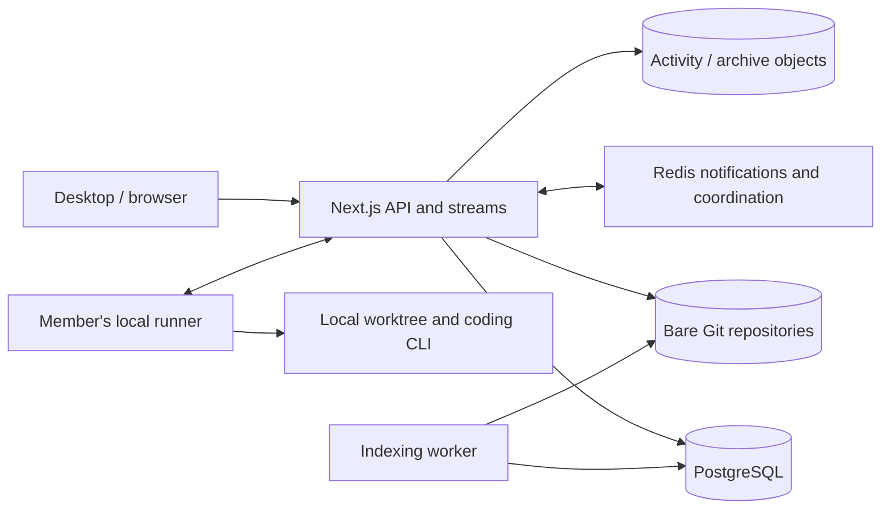

# Architecture

A short map of the load-bearing decisions. It documents *why* the system is
shaped the way it is and where its current boundaries are — read it before
changing the session, repo, or run-execution layers.

## Deployment and durable state

The supported beta target is one repository-owning server with a persistent
volume, PostgreSQL, Redis, a Next.js web process, and an indexing worker.
Desktop runners execute coding agents on members' computers. Keep
`LOCAL_RUNNERS=1` and `AGENT_WORKER=0` on the hosted service.
The terminal panel opens shells on members' own computers too, in their chats'
worktrees, relayed through the runner (`app/lib/terminal/remote.ts`).
`MULTIPLAYER_AI_TERMINAL` only matters where runners cannot connect: setting it
to `1` is an explicit operator decision that gives every signed-in member a
shell on the machine serving the app — see `docker/README.md`. It never changes where agents run: the
server runs an agent itself only with `AGENT_SERVER_EXECUTION=1`, or on a
development server that cannot reach runners (`app/lib/ai/execution.ts`). This is a
modular application with separate execution processes; adding independent web
hosts is not yet a supported storage topology.

PostgreSQL owns accounts, access, project/repository relationships, messages,
turns, runner jobs, queued chat inputs, checkpoint metadata and indexing jobs.
Git owns accepted code and checkpoint trees. The object store owns compressed
activity batches and optional cold Git archives. Redis carries notifications
and coordination; it is not the durable record of a local runner's job.

`MULTIPLAYER_AI_DATA` defaults to `./.multiplayer-ai`:

- `repos/<room-repository-id>.git`: room repository history.
- `projects/<repository-id>.git`: shared project repository history.
- `objects/`: default local object store, including compressed activity.
- `work/`: legacy/development checkouts; inspect before removing them.

Back up PostgreSQL, Git and object data together. Switching `STORAGE_PROVIDER`
to S3-compatible storage changes the object adapter; it does not move all
active Git operations to that provider or enable multiple repository owners.

## Projects contain repositories; rooms contain chats

A project is a collaboration space with membership, rooms, and zero or more
shared repositories. Creating a project or member room does not create a repo.
An editor/manager has one member room per project. A viewer does not receive an
editable room until promoted. Each room can import multiple repositories, and
each AI chat (`agent_runs`) targets one selected repository in that room.
Multiple turns belong to the same chat (`agent_turns`); they are distinct
execution attempts, with one current driver and a versioned handoff state.
A chat normally works on the room repository's branch. A **parallel chat**
works on its own `chat/<run id>` branch forked from it, so several can run at
once, and reaches the room branch only through an explicit, reviewed merge. See
[parallel chats](docs/parallel-chats.md).

An imported folder is filtered and streamed into Git objects and a private
import index on the server. Finalization creates a tree and commit. Ordinary
uploads do not leave a full extracted working directory on the server. Git
stores compressed content addressed by hashes; hashes identify content and are
not encrypted files. This saves checkout space, but Git history, checkpoints,
indexes and compressed activity still consume persistent disk space.

An import initially belongs to its room. **Share repository** explicitly adds a
shared repository to the project. Other project members can **Add to room** to
create independent room branches. **Publish** and **Get latest** merge only the
selected repository through Git objects. These operations target app-managed
repositories, not GitHub. Legacy primary repositories remain explicitly mapped
for existing chats; a null `repo_id` is a compatibility path, not a project-wide
implicit default. See [projects and repositories](docs/project-repositories.md).

Room access derives from active organization membership, project permissions,
visibility, and explicit room membership. An invitation to one room does not
make every project repository visible. Organization channels/DMs use a separate
`conversation_access_role` rule: public channels require active org membership;
private channels and DMs additionally require explicit conversation membership.
Explicit membership never overrides suspension. Org roster changes serialize
at the org row and recheck the actor inside the write transaction.

## A turn, from submission to offline review

1. The server authorizes the current driver and control version, then atomically
   reserves a turn under the organization's admission lock. Concurrency, project
   hourly limits and org monthly limits apply to continuations as well as new
   chats. Period usage counts accepted turns, including failed executions;
   queued instructions within a turn remain part of that turn. These limits
   are not a dollar/token billing meter.
2. A PostgreSQL runner job routes work to the user's compatible paired device.
   The runner receives a push wakeup, claims work with a lease, fetches missing
   Git objects and prepares the repository's persistent local worktree.
3. The CLI executes locally. A filesystem lock serializes chats sharing that
   worktree. The runner durably queues activity and checkpoints for upload;
   acknowledgements follow server persistence and validation.
4. Additional chat instructions are stored in `agent_run_inputs`, ordered per
   active turn and protected by driver/version/lease checks. Codex can accept
   native steering; one-shot CLI providers consume them after the current
   response. Delivery uncertainty is shown rather than silently replayed.
5. Candidate commits upload to turn-specific refs. The server verifies ownership,
   ancestry and expected base before promoting accepted code (onto the room
   branch, or a parallel chat's own branch) and recording the transcript,
   result, diffs and memory work. Local completion outboxes retry
   reports after disconnects without rerunning an already completed agent.
6. Teammates read acknowledged messages, code, activity and checkpoints from the
   server while the author's laptop is off. They cannot see unsynchronized
   local edits or unsaved buffers. A handoff/recovery changes the driver and
   control version; selecting a checkpoint prepares restoration on the next
   driver's machine. Recovery protects local dirty worktrees from overwrite.

See [workspace synchronization](docs/workspace-sync.md) for checkpoint contents,
limits, storage adapters and offline recovery.

## Persistent worktrees on each runner

`runner/git.ts` keeps a worktree and local branch per room repository, shared by
that room's ordinary chats and turns. A parallel chat gets a worktree and branch
of its own, sharing the repository cache, and a runner runs up to `--parallel`
turns at once (default 3). The server only hands out overlapping turns for
separate worktrees. Primary forks of the same project share one local
bare cache; imported repos stay separate. Cache/workspace identities are scoped
to the server URL and app user. This local optimization does not combine the
server's separately authorized room repositories.

A filesystem lock spans agent execution and candidate push. Reuse requires a
clean workspace whose head can fast-forward to the assigned base; no reset or
clean discards edits, ignored configuration, or undelivered commits. Candidate
pushes, server verification, and handoff ownership checks remain per turn.
See [runner workspaces](docs/runner-workspaces.md) for layout and recovery.

## Run execution uses local runners in hosted deployments

Agents execute on the *initiating member's own machine* when one of their
paired devices is online (docs/local-execution.md) — their CPU, their AI
login. The hosted Compose profile disables server execution and requires an
online compatible runner. Local development can explicitly allow server
execution. One job shape (`AgentRunJob`), three transports, one browser contract:

1. **Local:** the run route parks the job in `runner_jobs`; the user's runner
   wakes through `/api/runner/events` and claims it (atomic `SKIP LOCKED`), then fetches
   the repo over the device-authenticated git smart-HTTP endpoint
   (`/api/git/[repoRef]/…` — deny non-fast-forward, deny deletes), executes,
   streams events up (`/api/runner/runs/[id]/events` → the per-run Redis
   channel), and reports `/complete`, where the claimed commit is verified
   against the bare repo before any head moves. Requires Redis; a job no
   device collects within ~20s fails with a reconnect message, without fallback.
2. **Server worker:** BullMQ, when the queue is enabled.
3. **Inline:** in the web process, so local dev needs no extra infrastructure.

Local and cloud runs end through one shared finalization
(`app/lib/ai/finalize.ts`): head advance, transcript turn, diff stats, room
events, memory ingest — indistinguishable from the transcript out. The runner
itself stays dumb: it states facts and never writes the database.

Legacy server-side execution still uses a local data root and isolated turn
clones. It is disabled in the hosted profile; local runner worktrees do not
change that development-only execution path.

## Notifications, retention and recovery limits

The client shares room/account SSE connections and refreshes authoritative state
on reconnect. Team chat rechecks the captured login token and conversation
permission before sending text; stream queues are bounded. Room streams recheck
access on role changes and periodically. Callbacks use the original stream's
token rather than reading cookies from a shared Redis callback's request context.
Pub/Sub itself is not a replay log; durable transcripts and activity are separate.

Listing rooms never deletes user data. The old request-triggered 7/30-day
archive/delete sweep was removed. `npm run storage:maintain` is a dry-run
inspection; applying it only removes verified recoverable legacy checkouts and
prunes eligible checkpoints while retaining the latest and referenced ones.
Cold Git cache eviction is separately configured and verifies durable archives.
Neither mechanism authorizes deleting a user's local worktree.

This design still needs operational hardening: repository lock-loss fencing,
automatic reconciliation of abandoned turns, coordinated backup/restore drills,
and sustained capacity measurements. See the [current review](docs/architecture-review-2026-10-01.md)
for verified fixes, remaining risks and the next stages.

## Graceful degradation

Optional infrastructure fails open, so the product still works when it is
absent:

- **Presence:** Redis when `REDIS_URL` is set, in-process otherwise
  (`app/lib/presence/index.ts`).
- **Shared memory:** Postgres keyword retrieval always works. Optional Mnemosyne
  adds semantic candidates; delivery failures remain in `memory_jobs` for retry.

## The knowledge layer

There are two separate structures in `app/lib/knowledge/`:

- `graph.ts` derives project → visible rooms → runs plus repository context.
  This tree chooses accessible sources and ranks room activity; it is not a fact
  graph. `router.ts` chooses own-room/code context or broader project discussion.
- `memory_edges` persists typed relationships between source-backed memory
  records, messages, and code turns: supersedes, supports, contradicts,
  discussed_in, implemented_by, and mentions_file. Recursive SQL traverses up to
  four hops. No separate graph database is needed.

Migration 030 adds `memory_records`, `memory_events`, `memory_edges`, and
`memory_jobs`. Run completion stores its historical episode and outbox jobs in
the transcript transaction. Model extraction creates multiple proposed facts or
procedures with exact evidence quotes. Editors explicitly approve, replace, or
retract claims. Project-fork code episodes additionally need a verified ancestor
commit in project main. Publish triggers this check; a durable job retries it
after crashes. Publishing an episode does not approve the model's claims.

The worker uses Postgres leases and retry backoff, without Redis for memory.
Approved records may be projected into Mnemosyne `records-<roomId>` banks with
stable IDs and revisions. Autonomous sidecar consolidation is disabled. The app
uses candidates from those banks plus Postgres full-text search, then rechecks
source hashes, permissions, scope, and lifecycle before returning attributed
records. Supersession traversal resolves an old decision to its current approved
replacement. Legacy free-form sidecar facts are not injected into prompts.

Repository retrieval is independent: migration 029 stores per-SHA snapshots,
symbol/line chunks, full-text indexes, optional pgvector embeddings, and durable
indexing jobs in Postgres. The actual repositories and per-turn commits remain
on disk in Git. Memory edges point to verified turn SHAs and changed paths;
the agent still reads and edits the checkout through its tools.

See [the implementation guide](docs/memory-management.md) for configuration,
upgrade behavior, API and UI workflows, and the retrieval evaluation harness.
